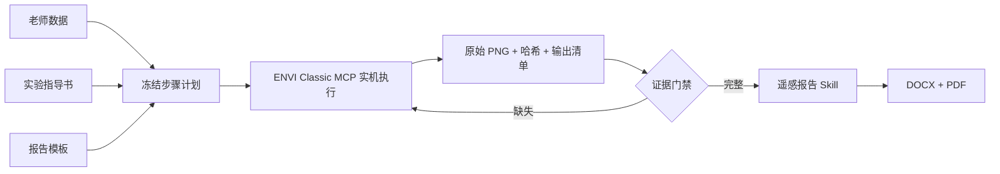

# ENVI Classic 遥感实验自动化

## 能力组成

- `envi-classic` MCP：发现 ENVI 安装、启动隔离会话、调用原生菜单、执行受限窗口内操作、保存截图并计算 SHA-256。
- `envi-classic-lab-automation` Skill：从指导书建立并冻结“步骤—截图”计划，调度实验与证据门禁。
- `remote-sensing-report` Skill：以老师模板和已验真的证据包为依据撰写、排版并检查 Word/PDF。



## 截图真实性约束

- 报告只能使用 MCP 捕获或用户明确提供的原始截图。
- 禁止用 Python、Pillow、OpenCV 或其他图像工具裁剪、标注、拼接、增强、重绘截图。
- 对照展示时，在 Word 中把两个原始图片对象左右或上下排版；不得生成新的合成位图。
- 同一截图不能冒充多个实验步骤；截图缺失时证据门禁必须失败。

## 环境要求

- Windows 10/11（64 位）；
- 已安装并能正常启动的 ENVI Classic 5.6（64 位）；
- Python 3.11 或更高版本；
- 支持本地 stdio MCP 的 Codex 或其他 MCP 客户端；
- 生成 Word/PDF 时另需可用的文档处理能力，例如 Microsoft Word 或 LibreOffice。

## 本地安装

```powershell
git clone https://github.com/xuedai-mayi/envi-classic-remote-sensing.git
Set-Location .\envi-classic-remote-sensing
powershell.exe -ExecutionPolicy Bypass -File .\scripts\setup.ps1 -Dev
```

运行自动测试：

```powershell
.\.venv\Scripts\python.exe -m pytest
```

运行 MCP 服务：

```powershell
powershell.exe -ExecutionPolicy Bypass -File .\scripts\run_mcp.ps1
```

`.codex-plugin/plugin.json`、`.mcp.json` 和两个 `skills/*/agents/openai.yaml` 已包含 Codex 插件元数据。将仓库根目录作为本地插件源加载即可同时启用 MCP 与 Skills。

## 典型输入目录

```text
my-experiment/
├─ 实验指导书.pdf
├─ 实验报告模板.docx
└─ 实验数据/
   ├─ image.dat
   └─ image.hdr
```

推荐提示词：

> 使用 ENVI Classic 5.6，严格按老师指导书完成这个实验。登记老师的数据、指导书和模板，冻结全部步骤后逐步实机操作并保存原始截图；对照图只在 Word 中左右或上下排版，禁止修改图片。证据完整后生成 Word 和 PDF。

## 安全边界

- 只控制由 MCP 自己启动的 ENVI 进程；
- 不暴露任意 PowerShell、CMD、IDL 或 Python 执行工具；
- 原生菜单按命令调用，自绘对话框只允许在所属 ENVI 窗口内使用相对坐标；
- 实验输入只读使用，新结果写入工作区的 `.envi-runs/<run-id>/`；
- 强制结束会话必须显式传入 `force=true`；
- `complete=false` 时不得生成或宣称实验报告已完成。

更完整的设计与证据格式见 [docs/architecture.md](docs/architecture.md) 和 [docs/evidence-contract.md](docs/evidence-contract.md)。

## 期末复习资料

仓库额外收录了“遥感数字图像处理”课程的两份期末资料，见 [final-exam-materials](final-exam-materials/README.md)。这些文件不参与 MCP 安装或运行。

## 开发与贡献

请先阅读 [CONTRIBUTING.md](CONTRIBUTING.md)。严禁向 issue、PR 或提交记录上传课程数据、个人信息、截图、报告成品和 ENVI 安装文件。

## 许可证与声明

代码以 [MIT License](LICENSE) 发布。第三方软件与商标声明见 [NOTICE.md](NOTICE.md)。
